  

# Awesome Robotics Frameworks & Embedded Control 🤖⚡

  
  
  
  
  
  
  

> 🚀 **A curated directory of production-grade robotics operating systems, deterministic embedded real-time control runtimes, physics simulation engines, SLAM navigation stacks, autonomous flight stacks, and cloud RobOps platforms.**

---

## 📈 Sector Overview & Market Dynamics

The global robotics software and operations market is valued at approximately **$24.4 billion in 2025** and projected to surpass **$29.6 billion by 2026**, registering a Compound Annual Growth Rate (CAGR) of ~18–22% fueled by rapid advances in embodied AI foundation models, physical AI simulation, and automated mobile fleet adoption.

**Market Concentration:** The sector exhibits **moderate fragmentation with transitional consolidation**. While cloud hyperscalers (NVIDIA, Amazon Web Services) and industrial automation conglomerates (ABB, Siemens, KUKA) anchor high-performance computing, GPU simulation, and manufacturing infrastructure (~35–42% share), the broader software ecosystem remains heavily fragmented across specialized open-source middlewares (ROS 2, Zenoh, Dora-rs), real-time embedded RTOS frameworks, and niche fleet telemetry SaaS startups. Strategic M&A and open standards continue to bridge standalone toolchains into unified RobOps stacks.

---

## 📑 Table of Contents

- [📈 Sector Overview & Market Dynamics](#-sector-overview--market-dynamics)
- [☁️ SaaS & Hosted RobOps Platforms](#️-saas--hosted-robops-platforms)
- [🛠️ Open-Source Robotics Frameworks & Embedded Control](#️-open-source-robotics-frameworks--embedded-control)
  - [🧠 Embodied AI, Autonomous Driving & Physics Simulation](#-embodied-ai-autonomous-driving--physics-simulation)
  - [⏱️ Real-Time Operating Systems & Autopilot Stacks](#️-real-time-operating-systems--autopilot-stacks)
  - [🌐 Middleware, Navigation & Manipulation Ecosystems](#-middleware-navigation--manipulation-ecosystems)
  - [⚙️ Actuator Firmware, SLAM & Deterministic Runtimes](#️-actuator-firmware-slam--deterministic-runtimes)
- [🧩 Recommended Stack Combinations](#-recommended-stack-combinations)
- [🤝 How to Contribute](#-how-to-contribute)
- [💖 Support](#-support)
- [📊 Star History](#-star-history)
- [⚠️ Disclaimer](#️-disclaimer)

---

## ☁️ SaaS & Hosted RobOps Platforms

The following hosted robotics cloud platforms, simulation environments, and fleet teleoperation infrastructure providers are ordered by enterprise scale (market capitalization or venture valuation / ARR in descending order).

| 🏢 Platform | 💰 Company Size (Valuation / Market Cap / Revenue) | 🏷️ Starting Price (Paid Tier) | 🎁 Free Tier / Free Trial Limits | 📝 Description |
| :--- | :--- | :--- | :--- | :--- |
| **[NVIDIA Isaac Sim & Isaac Cloud](https://developer.nvidia.com/isaac-sim)** | **~$3.5 Trillion** (Market Cap) | **$4,500 / GPU / year** (NVIDIA AI Enterprise license with SLA/support) | **Free forever** for individuals/workstation dev via NVIDIA Developer Program; 90-day free trial for NVIDIA AI Enterprise | Photorealistic, GPU-accelerated robotics simulator and synthetic data generator built on Omniverse and PhysX 5. |
| **[AWS RoboMaker](https://aws.amazon.com/robomaker/)** | **~$2.2 Trillion** (Amazon Market Cap) | **$0.40 / Simulation Unit-hour** (1 SU = 1 vCPU, 2 GB RAM) *(Service retired Sept 2025; shifted to AWS Batch)* | **Historical 25 SU-hours / month** free trial for first month; replaced by AWS Free Tier on AWS Batch / EKS | Cloud infrastructure for running large-scale parallel Gazebo/ROS regression simulation suites and CI/CD pipelines. |
| **[DroneDeploy (Transcend / Rocos)](https://www.dronedeploy.com)** | **$845 Million** (Acquired by Procore; ~$65M–$78M ARR) | **$159 / month** (Ag Lite) or **$349 / month** (Flight & Analysis, annual) | **14-day free trial** with full reality-capture and fleet inspection features; no credit card required | Enterprise ground robot and aerial drone mission control, automated reality capture, and inspection analytics. |
| **[Viam](https://www.viam.com)** | **~$200M–$300M** est. ($117M Total Raised, Series C) | **$0.05 / GB** storage & **$0.0025 / s** compute (pay-as-you-go) | **$5.00 / month free cloud credit forever**; core local edge runtime (`viam-server`) is 100% open-source (AGPL-3.0) | Cloud-connected robotics data capture, ML model deployment, and remote fleet management platform. |
| **[Foxglove Cloud](https://foxglove.dev)** | **~$150M–$250M** est. ($58.7M Raised, Series B; ~$5M ARR) | **$20 / user / month** (Team / Pro Plan) | **Free forever plan**: up to 3 users, 5 connected devices, 10 GB cloud storage, 100 GB egress/mo, 1,000 episodes/mo | Cloud MCAP log management, indexed search, collaborative dashboards, and data visualization for ROS 2. |
| **[Formant](https://formant.io)** | **~$100M–$150M** est. ($45M Total Raised, Series B; >500% YoY growth) | **~$250 / robot / month** (Custom quote-based enterprise fleet tier) | **Free forever tier**: 1 user seat with live teleoperation, real-time telemetry streaming, SSH tunnels, and simulated robot access | Teleoperation, observability, and data pipeline platform for autonomous mobile robots and industrial manipulators. |
| **[InOrbit](https://www.inorbit.ai)** | **~$37 Million** est. ($13.5M Total Raised, Series A; ~$1.7M ARR) | **Flat-rate annual plan** for Developer Edition (up to 8 robots) or usage-based per Monthly Active Robot (MAR) | **Free forever edition**: unlimited connected robots, real-time telemetry, live map positioning, and basic incident alerts | RobOps and multi-vendor fleet orchestration platform providing real-time tracking, incident dispatch, and spatial analytics. |
| **[Freedom Robotics](https://www.freedomrobotics.ai)** | **~$20M–$30M** est. ($6.6M Total Raised) | **Per-device monthly usage fee** (Standard / Plus / Professional tiers via console billing) | **Free prototype tier**: supports 1 active robot/device with basic telemetry streaming and teleoperation | Low-latency WebRTC teleoperation, data logging, time-series visualization, and OTA fleet diagnostics. |
| **[CoppeliaSim](https://www.coppeliarobotics.com)** | **Private / Bootstrapped SME** (Global academic & industrial footprint) | **Quote-based commercial license** (~$1,200–$3,500 perpetual / annual license) | **Free forever educational license (`CoppeliaSim Edu`)**: unlimited scenes and simulation nodes for students/professors/schools | Multi-physics kinematics and dynamic robot simulator featuring distributed Lua, Python, C++, and ROS/ROS 2 APIs. |

---

## 🛠️ Open-Source Robotics Frameworks & Embedded Control

Top open-source projects across physical AI, autonomous driving, real-time operating systems, robotics middleware, motion planning, motor control, and visual SLAM.

Sorted in descending order by GitHub stargazer count:

### 🧠 Embodied AI, Autonomous Driving & Physics Simulation

- **[Genesis](https://github.com/Genesis-Embodied-AI/genesis-world)**  — Ultra-fast, universal physics simulation platform designed for general-purpose robotics, embodied AI foundation models, and reinforcement learning.
- **[LeRobot](https://github.com/huggingface/lerobot)**  — Hugging Face's open-source PyTorch ecosystem for end-to-end imitation learning, Vision-Language-Action (VLA) neural policies, and low-cost robotic arms.
- **[Apollo](https://github.com/ApolloAuto/apollo)**  — High-performance, production-grade autonomous driving software stack by Baidu featuring RTOS kernel modules, perception, HD mapping, and planning.
- **[MuJoCo](https://github.com/google-deepmind/mujoco)**  — Google DeepMind's multi-joint dynamics with contact physics engine engineered for contact-rich robot manipulation, locomotion, and biomechanics.
- **[Bullet Physics](https://github.com/bulletphysics/bullet3)**  — Real-time multi-physics SDK offering collision detection, rigid body dynamics, articulated bodies, and soft body simulation via PyBullet.
- **[Webots](https://github.com/cyberbotics/webots)**  — Open-source (Apache-2.0) comprehensive 3D mobile robot simulator with hundreds of calibrated robot models, sensor interfaces, and multi-robot environments.
- **[Autoware Universe](https://github.com/autowarefoundation/autoware_universe)**  — Complete open-source autonomous driving stack built on ROS 2, featuring 3D LiDAR pointcloud localization, vector map routing, and model predictive control (MPC).
- **[Gazebo Sim](https://github.com/gazebosim/gz-sim)**  — The modern open-source 3D robotics simulation platform (formerly Ignition Gazebo) featuring modular physics backends (DART, Bullet), sensor simulation, and direct ROS 2 integration.

### ⏱️ Real-Time Operating Systems & Autopilot Stacks

- **[Zephyr RTOS](https://github.com/zephyrproject-rtos/zephyr)**  — Scalable, memory-protected, security-focused real-time operating system for resource-constrained microcontrollers, CAN-FD, BLE, and EtherCAT fieldbus nodes.
- **[ArduPilot](https://github.com/ArduPilot/ardupilot)**  — Reliable, versatile GPLv3 open-source autopilot codebase for drones, rovers, fixed-wing airplanes, VTOLs, and underwater ROVs with SITL simulation support.
- **[PX4 Autopilot](https://github.com/PX4/PX4-Autopilot)**  — Professional open-source flight management stack running on NuttX RTOS and embedded Linux, featuring native uORB messaging, MAVLink, and micro-XRCE-DDS bridge.
- **[FreeRTOS Kernel](https://github.com/FreeRTOS/FreeRTOS-Kernel)**  — De-facto standard deterministic, market-leading microkernel for deeply embedded microcontrollers (STM32, ESP32, NXP, RP2040) powering high-frequency control loops.

### 🌐 Middleware, Navigation & Manipulation Ecosystems

- **[ROS 2](https://github.com/ros2/ros2)**  — The industry-standard robotics middleware suite built on DDS and Zenoh, supplying distributed publish/subscribe communication, lifecycle management, and hardware abstraction.
- **[Kalibr](https://github.com/ethz-asl/kalibr)**  — Visual-inertial camera-IMU calibration and multi-camera calibration toolbox by ETH Zurich Autonomous Systems Lab.
- **[Nav2 (Navigation 2)](https://github.com/ros-navigation/navigation2)**  — Production-grade autonomous mobile robot (AMR) navigation stack for ROS 2 with dynamic costmaps, behavior trees, collision avoidance, and waypoint following.
- **[BehaviorTree.CPP](https://github.com/BehaviorTree/BehaviorTree.CPP)**  — High-performance C++ behavior tree framework providing asynchronous execution, logging, and graphical editing for complex robot decision logic.
- **[Dora-rs](https://github.com/dora-rs/dora)**  — Ultra-low latency, dataflow-oriented robotics middleware written in Rust utilizing zero-copy Apache Arrow shared memory for deep learning pipelines.
- **[Eclipse Zenoh](https://github.com/eclipse-zenoh/zenoh)**  — Minimalist, high-throughput pub/sub/query communication protocol (`rmw_zenoh`) bridging microcontrollers, ROS 2 nodes, and cloud WAN brokers.
- **[CasADi](https://github.com/casadi/casadi)**  — Symbolic framework for algorithmic differentiation and non-linear numerical optimization, widely used for Model Predictive Control (MPC) and trajectory planning.
- **[MoveIt 2](https://github.com/moveit/moveit2)**  — Premier manipulation, inverse kinematics (IK), 3D obstacle perception, and trajectory generation framework for multi-axis robotic arms in ROS 2.
- **[ros2_control](https://github.com/ros-controls/ros2_control)**  — Modular real-time resource-manager and hardware abstraction layer for controlling actuators, sensors, and transmissions in ROS 2.
- **[Universal Robots ROS 2 Driver](https://github.com/UniversalRobots/Universal_Robots_ROS2_Driver)**  — Official real-time ROS 2 driver with cartesian velocity and trajectory control interfaces for UR3, UR5, UR10, UR16, and e-Series cobots.
- **[micro-ROS](https://github.com/micro-ROS/micro_ros_setup)**  — Architecture bridging ROS 2 nodes directly onto resource-constrained MCUs running FreeRTOS, Zephyr, or NuttX over UART, CAN, or Ethernet.
- **[OpenRMF](https://github.com/open-rmf/rmf)**  — Multi-robot fleet orchestration and interoperability framework resolving route conflicts, traffic jams, automated elevators, and automated building doors.

### ⚙️ Actuator Firmware, SLAM & Deterministic Runtimes

- **[RTAB-Map](https://github.com/introlab/rtabmap)**  — RGB-D, stereo, and 3D LiDAR graph-based SLAM library with memory management for real-time long-term mapping and visual loop closure.
- **[VESC BLDC](https://github.com/vedderb/bldc)**  — Leading open-source brushless DC motor controller firmware for electric vehicles, quadruped actuators, and high-performance robotic drives.
- **[Grid Map](https://github.com/ANYbotics/grid_map)**  — Multi-layered 2.5D grid map library developed by ANYbotics for mobile robot rough-terrain navigation, elevation mapping, and variance estimation.
- **[SimpleFOC](https://github.com/simplefoc/Arduino-FOC)**  — Field Oriented Control (FOC) algorithm library for smooth, low-cogging, high-torque BLDC and stepper motor actuation on microcontroller boards.
- **[SLAM Toolbox](https://github.com/SteveMacenski/slam_toolbox)**  — Lifelong 2D laser SLAM mapping and localized pose-graph optimization tool for large-scale warehouse and factory environments.
- **[Copper-rs](https://github.com/copper-project/copper-rs)**  — Deterministic, ultra-low jitter robotics operating runtime engineered in Rust with deterministic execution graphs and microsecond-level telemetry logging.
- **[Lichtblick](https://github.com/lichtblick-suite/lichtblick)**  — Integrated open-source (MPL-2.0) visualization and diagnosis suite for inspecting ROS 1/2 topics, 3D URDF assets, point clouds, and MCAP logs.
- **[RoboKit](https://github.com/openrobokit/robokit)**  — Modular open-source robotics toolkit offering unified hardware abstractions, sensor integrations, and reproducible robot software runtimes.

---

## 🧩 Recommended Stack Combinations

| 🎯 Application Domain | 🔌 Embedded Hardware & Firmware | 💻 Edge Compute & Middleware | 🧠 Planning & Control | 🔭 Simulation & Observability |
| :--- | :--- | :--- | :--- | :--- |
| **Autonomous Mobile Robots (AMRs)** | STM32 / ESP32 + Zephyr RTOS + micro-ROS | NVIDIA Jetson + ROS 2 (Zenoh RMW) | Nav2 + SLAM Toolbox + BehaviorTree.CPP | Gazebo Sim + Foxglove Cloud / Lichtblick |
| **Robotic Manipulators / Cobots** | Custom BLDC drivers + SimpleFOC / VESC | Industrial PC + ROS 2 + ros2_control | MoveIt 2 + CasADi (MPC trajectory generation) | MuJoCo + Formant |
| **Aerial & Multirotor Drones** | Flight Controller (Pixhawk) + PX4 Autopilot | Companion Computer + micro-XRCE-DDS | MAVLink + Offboard ROS 2 Position Control | ArduPilot SITL / Gazebo + DroneDeploy |
| **Embodied AI & Humanoid Robots** | EtherCAT Bus + Zephyr RTOS + C++ real-time loops | Multi-GPU Edge Box + Dora-rs | LeRobot (VLA policies) + CasADi Whole-Body Control | Genesis / Isaac Sim + InOrbit |

---

## 🤝 How to Contribute

1. Fork this repository.
2. Add or update tool listings in `README.md` following the established table and Stars_Badge formats.
3. Keep product descriptions objective, verified, and linked to official documentation or source code.
4. Submit a Pull Request describing your changes.

---

## 💖 Support

Thank you for exploring and using this repository! If you find this curated collection helpful for your robotics architecture or research:

- ⭐ **Star this repository** to help others discover it on GitHub.
- 🍴 **Fork and contribute** to keep entries, firmware options, and tools up-to-date.
- 📢 **Share with colleagues** in the robotics, embedded systems, and embodied AI communities.
- ☕ **Support future work & maintenance:** You can sponsor or buy a coffee via the [GitHub Sponsor Dashboard](https://github.com/sponsors/ishandutta2007).

---

## 📊 Star History

---

## ⚠️ Disclaimer

- This is a community-curated directory intended for research, architectural planning, and educational purposes.
- Physical robotics, autonomous vehicles, and high-power actuators present inherent risks of mechanical failure or injury. Always incorporate hardware emergency stops (E-Stop), watchdog timers, physical limit switches, and conduct extensive simulated testing before powering physical hardware.
